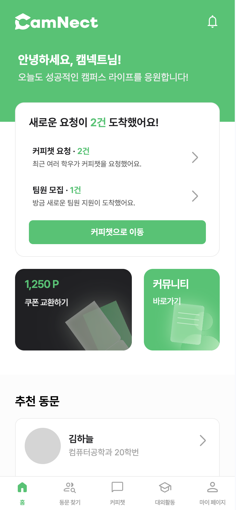
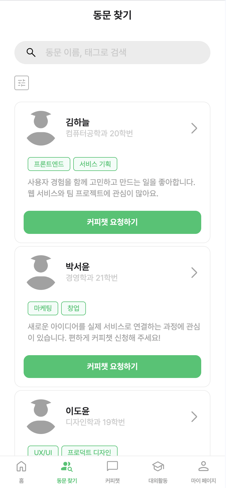
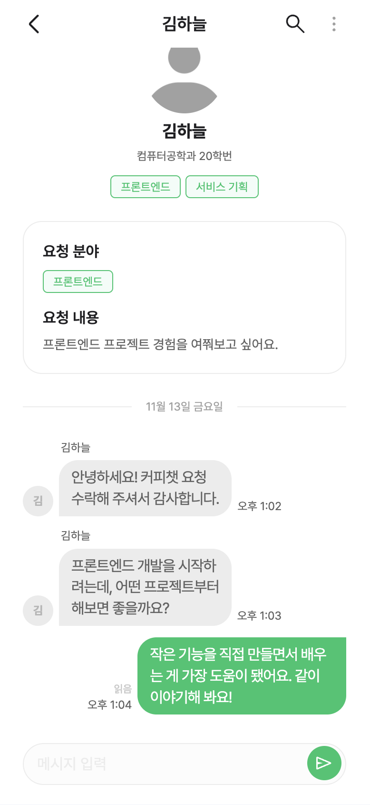
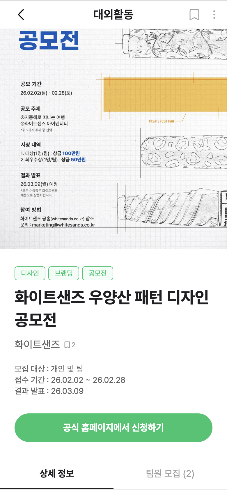
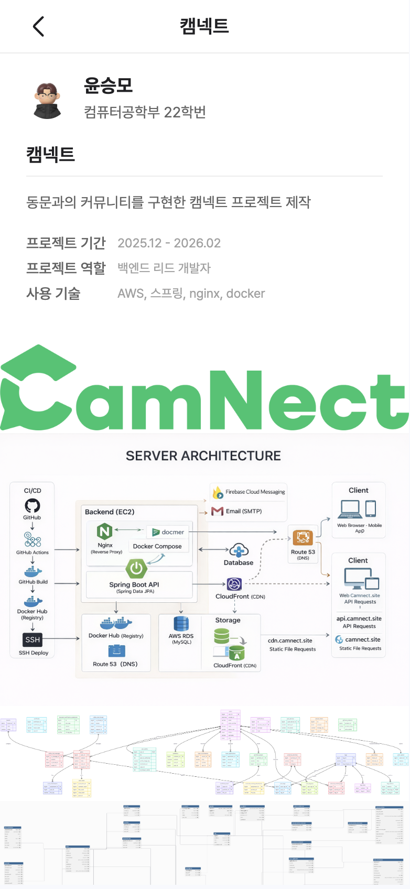
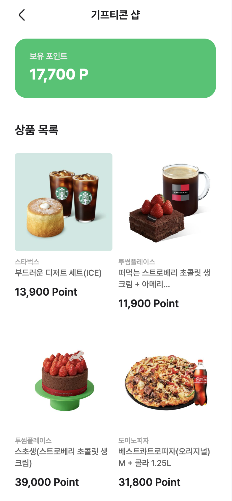

# CamNecT (캠넥트)

> 대학생을 위한 동문 네트워킹 · 커피챗 · 커뮤니티 웹앱

[🌐 서비스 바로가기](https://camnect.site/)

CamNecT는 동문 탐색과 포트폴리오 공유, 커뮤니티, 대외활동 및 팀원 모집, 실시간 커피챗을 연결해 대학생 간 교류를 돕는 서비스입니다.

## 📱 서비스 화면

개인정보 보호를 위해 예시 데이터로 구성한 화면입니다. 이미지를 누르면 크게 볼 수 있습니다.

| 홈 | 동문 찾기 | 커피챗 |
| :---: | :---: | :---: |
| <a href="./docs/screenshots/home.png"></a> | <a href="./docs/screenshots/alumni.png"></a> | <a href="./docs/screenshots/chat.png"></a> |

| 대외활동 | 포트폴리오 | 기프티콘 |
| :---: | :---: | :---: |
| <a href="./docs/screenshots/activity.png"></a> | <a href="./docs/screenshots/portfolio.png"></a> | <a href="./docs/screenshots/gifticon.png"></a> |

## 🔗 프로젝트 개요

- 개발 기간: 2026.01 ~ 현재
- 프론트엔드 개발 인원: 3명
- 서비스 형태: 모바일 중심 웹앱 · PWA

## 📃 주요 기능

### 🔐 인증 · 프로필

- 이메일 인증을 포함한 회원가입·로그인, 관심 분야 및 기본 프로필 설정, 학교 인증 자료 제출과 심사 상태별 화면
- 동문 검색·필터와 프로필 조회, 내 정보·학력·경력·자격증·포트폴리오 관리

### 💬 커피챗 · 실시간 채팅

- 커피챗 요청·수락, 채팅방 목록·검색·필터, STOMP 기반 실시간 대화와 읽음 상태 표시
- 여러 줄 메시지 입력, PC Enter 전송·Shift+Enter 줄바꿈, 모바일 Enter 줄바꿈
- 전송 실패·결과 미확인 메시지의 재시도와 실패 메시지 삭제

### 🏠 홈 · 커뮤니티 · 대외활동

- 커피챗 요청과 추천 동문·공모전 등 홈 콘텐츠
- 커뮤니티 게시글·댓글·답글 작성 및 관리, 질문 댓글 채택과 포인트로 잠긴 질문 열람
- 공모전·대외활동·동아리·스터디 탐색, 팀원 모집 글 작성과 지원·수락·거절

### 🎁 기프티콘 · 알림

- 보유 포인트·기프티콘 상품 조회와 포인트를 사용한 상품 구매
- 알림 목록·읽음 처리·관련 화면 이동, FCM 푸시 알림 토큰 등록

### 🚨 신고 · 관리자

- 프로필·게시글·댓글·채팅방 신고, 증거 이미지 첨부
- 학교 인증 심사, 콘텐츠 관리, 신고 내역 조회·처리

## ⚙️ 주요 기술 설계

### 끊겨도 이어지는 채팅

- ACK가 늦거나 연결이 끊겨도 메시지를 곧바로 실패로 단정하지 않습니다.
- `pending`·`sent`·`unconfirmed`·`failed` 상태를 나눠 전송 결과를 추적합니다.
- 미확정 메시지는 새로고침 후에도 복원합니다.
- STOMP 재연결 시 채팅방을 다시 구독하고 REST 내역을 재조회합니다.
- `clientMessageId`로 대기 메시지와 서버 메시지의 중복 표시를 막습니다.

### 대화 흐름을 지키는 새 메시지 안내

- 상대 메시지가 와도 읽던 위치를 유지하고, 화면 아래의 새 메시지만 미리보기로 안내합니다.
- `IntersectionObserver`로 말풍선 노출을 감지해 안내를 닫습니다.
- `ResizeObserver`로 입력창 높이에 맞춰 하단 여백을 조정해 메시지 가림을 방지합니다.

### 만료된 토큰을 안전하게 갱신

- Access Token 만료 시 Refresh Token Rotation(RTR) 후 원래 요청을 재시도합니다.
- 동시에 들어온 갱신 요청은 하나로 묶습니다.
- 이전 세션의 늦은 응답이 새 로그인에 반영되지 않게 합니다.

### 기프티콘 중복 구매 방지

- 연속 클릭으로 발생하는 중복 요청을 막습니다.
- 응답을 받지 못해 재시도할 때는 같은 `clientRequestId`를 보냅니다.
- 서버는 이를 동일한 구매 시도로 식별합니다.

### 신고 증거와 처리 과정 연결

- 증거 이미지의 사전 서명 URL을 일괄 발급받아 S3에 업로드합니다.
- 관리자는 신고 건별 증거를 확인하고 처리 상태를 변경할 수 있습니다.

### 오류 안내의 책임 분리

- 브라우저 오프라인은 전역 배너에서 안내합니다.
- HTTP 오류·시간 초과 등은 각 기능에서 처리합니다.
- 같은 문제에 여러 오류 UI가 겹치지 않도록 구분합니다.

## 🧭 개발 예정

- 기프티콘 구매 시 필수로 사용할 마이페이지 휴대전화 번호 인증과 구매·포인트 적립 내역 조회
- 동아리·스터디 게시글의 댓글 기능
- 이벤트별 푸시 알림 발송·수신 여부 설정
- 서비스 전 화면의 PC 뷰 지원
- 핵심 기능과 오류 상황을 검증하는 테스트 코드 추가

## 👥 팀 구성 및 역할 분담

### 정상현 (인프라 · 인증 · 채팅 · 푸시 알림)

- 프로젝트 기반 및 CI/CD, PWA 설정
- 인증·온보딩과 RTR 기반 세션 갱신
- 커피챗 실시간 채팅 및 전송 상태 관리
- FCM 푸시 알림 구현: 권한 요청·토큰 등록, 실시간 수신, Service Worker 알림 표시·클릭 이동

### 김나연 (마이페이지 · 포트폴리오 · 대외활동 · 신고)

- 마이페이지·포트폴리오 편집
- 대외활동·팀원 모집
- 사용자 신고 기능 및 관리자 신고 목록·상세 화면

### 조은서 (홈 · 커뮤니티 · 동문찾기 · 기프티콘)

- 홈·알림, 커뮤니티, 동문 탐색·프로필
- 기프티콘 샵, 전역 오프라인 안내와 도메인별 오류 처리

## 🧱 기술 스택

| 영역 | 기술 |
| --- | --- |
| 언어·UI | TypeScript, React 19, Vite, React Router |
| 스타일·인터랙션 | Tailwind CSS v4, Framer Motion |
| 데이터·상태 | TanStack Query, Axios, Zustand |
| 실시간·푸시 | STOMP, SockJS, Firebase Cloud Messaging |
| 폼·품질 | React Hook Form, Zod, ESLint |

## 🗂️ 프로젝트 구조

```text
src/
├── api/             # 서버 요청
├── api-types/       # 서버 요청·응답 타입
├── components/      # 공통 UI
├── constants/       # 오류 코드·안내 문구
├── hooks/           # 데이터 조회·실시간 연결
├── layouts/         # 공통 화면 레이아웃
├── pages/           # 인증·커피챗·커뮤니티·동문·상점 등 화면
├── router/          # 라우팅·접근 권한
├── store/           # 클라이언트 상태
├── styles/          # 전역 스타일
├── types/           # 화면에서 사용하는 타입
└── utils/           # 공통 유틸리티
```
